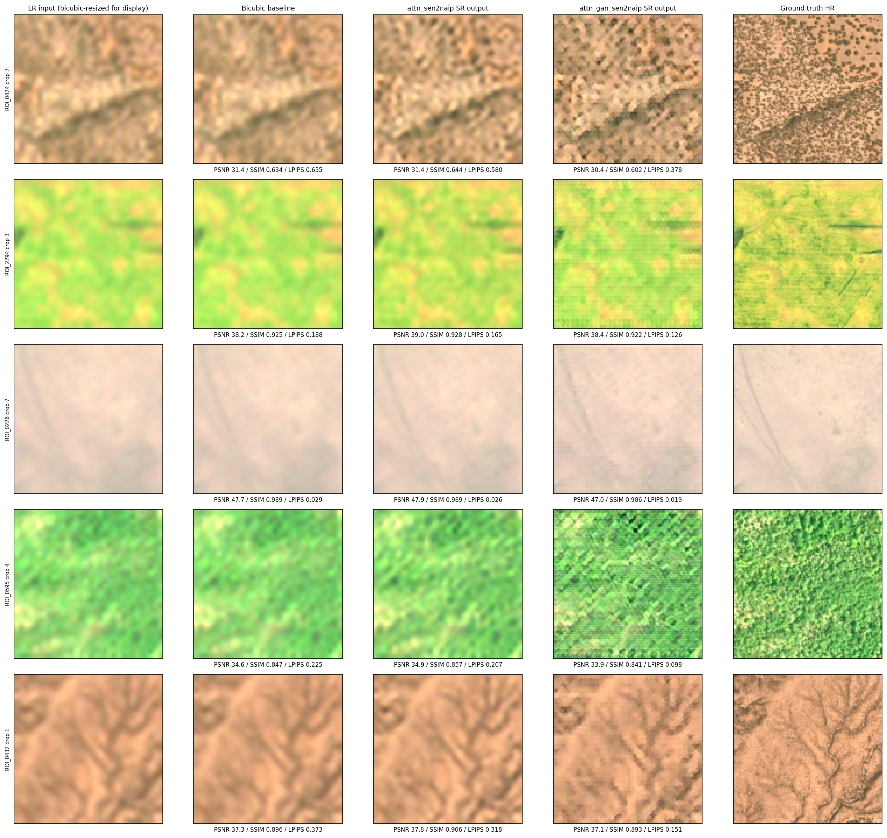

# SharpSat — Sentinel-2 Super-Resolution from 10 m to 2.5 m

Sentinel-2 imagery is super-resolved ×4, from **10 m to 2.5 m**, in four bands (R, G, B, NIR). The models are trained and evaluated on **real** Sentinel-2 → NAIP aerial pairs from [SEN2NAIP](https://huggingface.co/datasets/isp-uv-es/SEN2NAIP), not on artificially downsampled images. The project was built for Smart India Hackathon problem statement SIH26142.



- **Attention-RRDB (accuracy model):** residual-in-residual dense blocks with CBAM attention, a zero-initialised bicubic skip connection, and a Charbonnier + SSIM + NDVI-consistency loss. It scores best on PSNR, SSIM, SAM and ERGAS.
- **Attention-RRDB + GAN (visual model):** adversarial fine-tuning against a spectrally normalised PatchGAN, with an EMA of the generator weights for stable training. It has **51 % lower LPIPS**, so it gives the sharpest, most realistic output.
- **Uncertainty map:** Monte Carlo dropout highlights where the model is guessing. It tracks real error with a Spearman correlation of 0.82 per crop.
- **Web dashboard:** a FastAPI app with a split-view comparison, RGB, uncertainty and NDVI views, live metrics and a run history.

## Results

Results are on 150 held-out sites (1,350 crops), 10 m → 2.5 m.

| Model | PSNR ↑ | SSIM ↑ | SAM ↓ | ERGAS ↓ | LPIPS ↓ |
|---|---|---|---|---|---|
| Bicubic | 35.45 | 0.855 | 2.21 | 3.69 | 0.381 |
| Attention-RRDB | **35.66** | **0.860** | **2.14** | **3.57** | 0.321 |
| Attention-RRDB + GAN | 34.93 | 0.840 | 2.35 | 3.90 | **0.187** |

Training both models takes about 1 hour on a laptop GPU. A 384×384 output with its uncertainty map takes under a second.

---

## 1. Run the demo

The trained checkpoints aren't stored in git. Download them from the [Releases](../../releases) page into `web/checkpoints/`, or train your own (Section 2).

**Windows**
```bat
python -m venv .venv
.venv\Scripts\pip install -r web\requirements.txt
start_demo.bat
```

**macOS / Linux**
```bash
python3 -m venv .venv
.venv/bin/pip install -r web/requirements.txt
sh start_demo.sh
```

The dashboard runs at **http://localhost:8000**. A GPU is optional (CUDA and Apple MPS are detected automatically), and the demo also runs on CPU.

## 2. Train the models

```bash
pip install -r requirements.txt
python -m src.data.sen2naip --pairs 1500                          # download + harmonise 1,500 pairs (~1 GB)
python -m src.train_sen2naip --stage both                         # stage 1 (fidelity) then stage 2 (GAN)
python -m src.eval.perceptual_metrics --data sen2naip --compare   # test-set metrics
```

Copy the models into the dashboard and export the demo sites:
```bash
cp checkpoints/best_model_attn_sen2naip.pt checkpoints/best_model_attn_gan_sen2naip.pt web/checkpoints/
python -m src.data.sen2naip --export_web 8
```

---

## Project structure

```
├── start_demo.sh / start_demo.bat   # launch the dashboard
├── requirements.txt                 # training + evaluation + demo
├── src/                             # training and evaluation
│   ├── data/sen2naip.py             # SEN2NAIP download, radiometric harmonisation, quality filter
│   ├── models/rrdbnet_attn.py       # Attention-RRDB generator (RRDB + CBAM + MC dropout)
│   ├── models/discriminator.py      # spectrally normalised PatchGAN
│   ├── losses/                      # Charbonnier, SSIM, NDVI, VGG and adversarial losses
│   ├── train_sen2naip.py            # two-stage training entry point
│   ├── train_v2.py, train_v2_gan.py # stage 1 / stage 2 training loops (EMA)
│   ├── eval/                        # PSNR, SSIM, SAM, ERGAS, LPIPS, HF ratio
│   └── uncertainity/mc_dropout.py   # Monte Carlo dropout
├── web/                             # demo dashboard (FastAPI + HTML/JS)
│   ├── src/server.py                # backend
│   ├── frontend/                    # UI
│   └── configs/config.yaml          # model registry
└── demo/                            # result figures
```

## Acknowledgements

Data: SEN2NAIP (Aybar et al., 2024, CC-BY-4.0). This work builds on the S2GAN approach of Zhang, Sumbul and Demir (2020).
